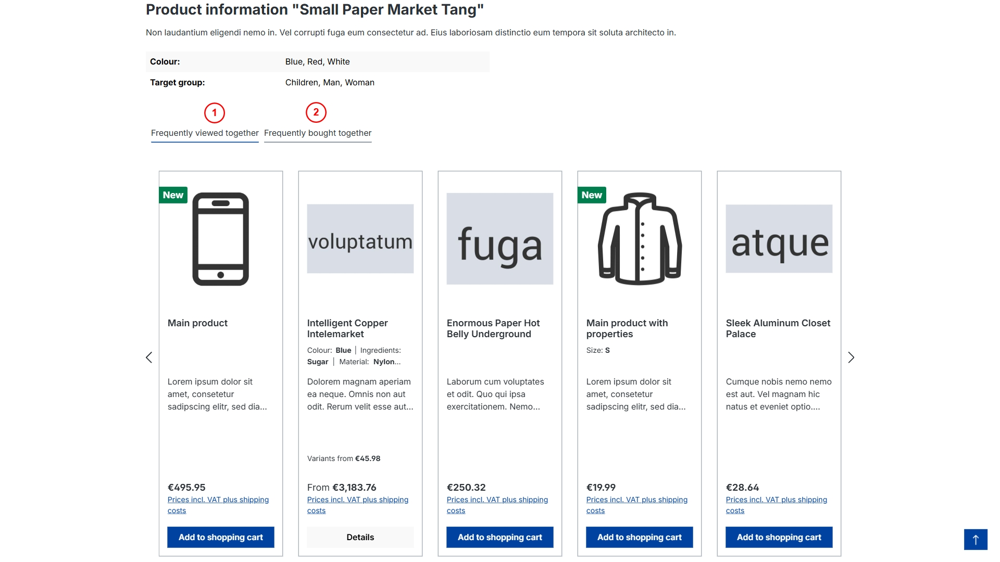
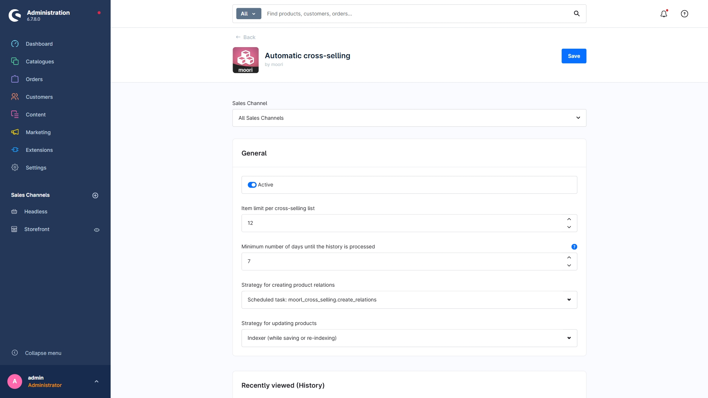
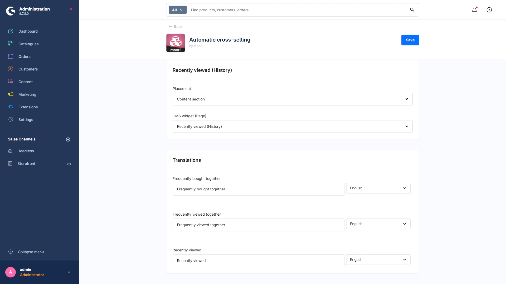
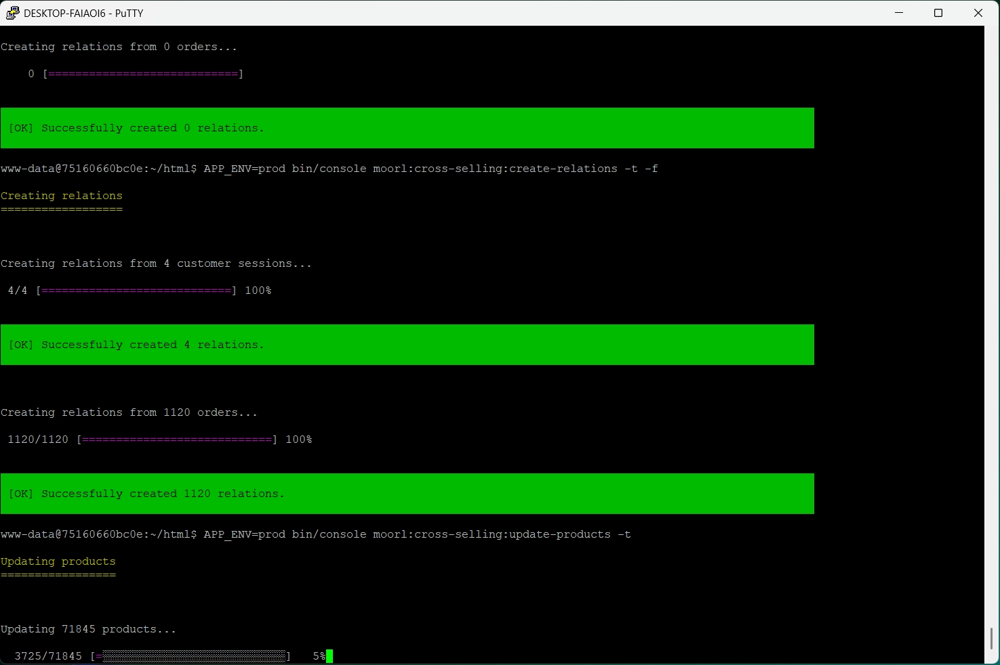
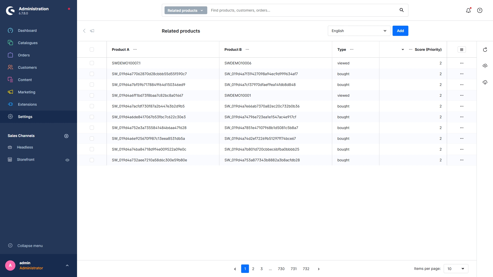
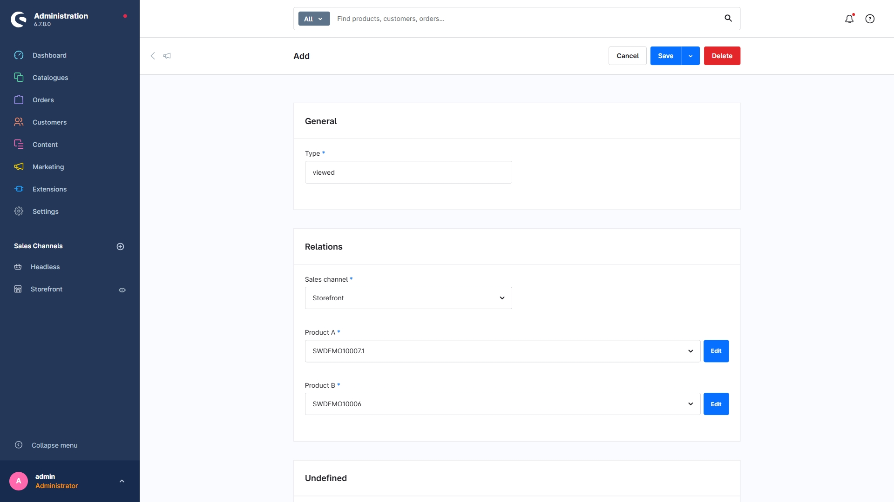

# {var:label_de_de}

{var:description_de_de}



---

{file:snippets/docs_buy_plugin.md}

{file:snippets/docs_foundation_note.md}

---

## Ersteinrichtung

### Plugin Konfiguration

In der Plugin-Konfiguration befinden sich alle notwendigen Einstellungen, um mit der Generierung von Cross-Selling-Listen zu starten.





#### Konfiguration

- **Aktiv**: Das Plugin ist für den aktuellen Verkaufskanal aktiv.
- **Artikelbegrenzung pro Cross-Selling-Liste**: Die generierten Listen werden auf diesen Wert limitiert.
- **Mindestanzahl an Tagen, bis der Verlauf verarbeitet wird**: Bleibt der Kunde während dieses Zeitraums inaktiv, wird der Verlauf verarbeitet und gelöscht.
- **Strategie zum Aufbau von Produktbeziehungen**: Automatisch via geplante Aufgabe oder über den Konsolen-Befehl: `bin/console moorl:cross-selling:create-relations`
- **Strategie zum Aktualisieren von Produkten**: Automatisch via Indexierung oder über den Konsolen-Befehl: `bin/console moorl:cross-selling:update-products`

#### Zuletzt angesehen (Verlauf)

- **Platzierung**: Wählen Sie eine Platzierung oder Deaktiviert
- **CMS Widget (Seite)**: Das CMS Widget mit dem Slider wird über AJAX geladen. Die Einstellungen können in der gleichnamen CMS Seite angepasst werden.

#### Übersetzungen

Hier werden die Namen für die Titel der Cross-Selling-Listen in allen Sprachen konfiguriert. Sollte keine Konfiguration vorhanden sein, dient die Systemsprache als Fallback.

### Konsolen-Befehle

Die Erfassung und Auswertung der Daten über geplante Aufgaben und Indexierung können viel Zeit beanspruchen. Um sofort brauchbare Listen zu erstellen, geht das über die Konsolen-Befehle.



#### Schritt 1: Zusammenhänge erkennen und erstellen

In diesem Schritt werden alle Bestellungen und Kundensitzungen eingelesen und ausgewertet.

**Hinweis**: Die Kundensitzungen werden laut Plugin-Einstellung erst 7 Tage inaktivität ausgewertet. Das hat den Grund, dass der Verlauf des Kunden zurückgesetzt und ein neuer Verlauf erstellt wird.

Führen Sie folgenden Befehl aus:

```
bin/console moorl:cross-selling:create-relations
```

Über die Hauptnavigation im Admin unter `Einstellungen` → `Verbundene Produkte` können Sie kontrollieren, ob der Befehl die Datensätze richtig angelegt hat.





#### Schritt 2: Zusammenhänge erkennen und erstellen